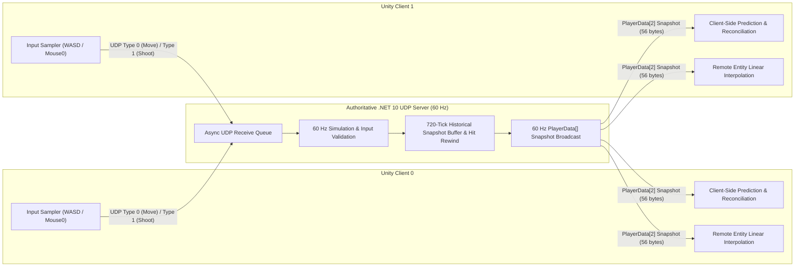
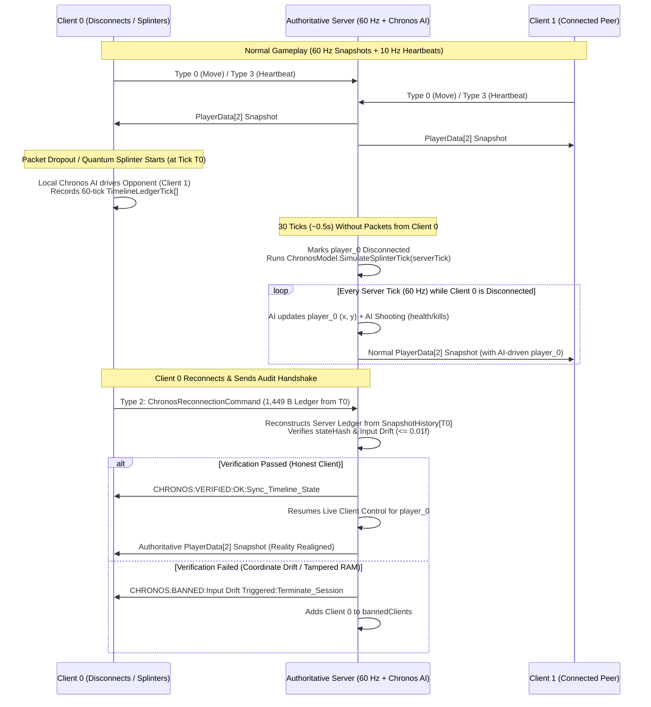

# Multiplayer Architecture: Basic Authoritative & AI-Integrated (Project Chronos)

**Last Updated:** 2026-10-31

---

## Part 1: Basic Authoritative Multiplayer Architecture

### 1.1 Overview & Topology
The base game uses a **Client-Server Authoritative UDP Architecture** designed for fast-paced 1v1 top-down shooter combat:
- **Authoritative Server ([`Server/Program.cs`](Server/Program.cs))**: A standalone **.NET 10** console application running a fixed **60 Hz (`16.67 ms`)** simulation loop over UDP port `11000`. The server owns the single source of truth for player coordinates, input sequence acknowledgments, health, cooldowns, and kill counts.
- **Game Clients ([`Client_TopDownShooter/Assets/Client.cs`](Client_TopDownShooter/Assets/Client.cs))**: **Unity 6 (URP)** clients that sample player inputs, render world state, and mask network latency via client-side prediction, server reconciliation, and entity interpolation ([`LagCompensation.cs`](Client_TopDownShooter/Assets/LagCompensation.cs)).
- **Shared Binary Library ([`Both/data.cs`](Both/data.cs))**: Compiled into both the .NET server and Unity (`MyExternalLibrary`), providing `Marshal`-backed binary packet structures (`Pack = 1`) and zero-overhead byte serialization (`DataPacketConvertor`).

---

### 1.2 Connection Handshake & Session Lifecycle
Before entering the 60 Hz simulation loop, the server coordinates a 3-way UDP handshake and synchronized match start for both players:
1. **Connection Request (`REQ` $\rightarrow$ `ACK_<id>` $\rightarrow$ `CNF`)**:
   - Each client sends `"REQ"` to the server.
   - The server assigns a `clientID` (`0` or `1`) and replies with `"ACK_0"` / `"ACK_1"`, retrying every 5 seconds until all connected clients respond with `"CNF"`.
2. **Synchronized Match Start (`Start` $\rightarrow$ `ACK`)**:
   - Once both clients are confirmed, the server broadcasts `"Start"`.
   - Clients instantiate the local and remote `PlayerObject` prefabs, configure cameras and health bars, and reply `"ACK"`.
   - Upon receiving `"ACK"` from both clients, the server initializes player state (`health = 100`) and starts the 60 Hz `Game()` loop.

---

### 1.3 Binary Wire Protocol
All gameplay packets sent from client to server are prefixed with a 1-byte packet `type` header followed by a tightly packed (`Pack = 1`) binary struct:

| Direction | Packet Type | Struct / Payload | Size | Purpose |
| --- | --- | --- | --- | --- |
| **Client $\rightarrow$ Server** | `0` | `MovementClientPacket` (`sequence`, `deltaX`, `deltaY`, `inputDuration`) | `17 B` | Sequenced movement command |
| **Client $\rightarrow$ Server** | `1` | `ShootingClientPacket` (`targetPlayerId`, `observedServerTick`, `baseInputSequence`, `inputCount`, `x`, `y`, `z`) | `29 B` | Raycast fire command with observed tick |
| **Client $\rightarrow$ Server** | `2` | `ChronosReconnectionHeader` + `TimelineLedgerTick[]` | `1,449 B` | 60-tick AI ledger audit on reconnect |
| **Client $\rightarrow$ Server** | `3` | `HeartbeatClientPacket` (`clientTick`) | `5 B` | 10 Hz keep-alive heartbeat |
| **Server $\rightarrow$ Client** | Snapshot | `PlayerData[2]` (`id`, `lastProcessedInput`, `serverTick`, `x`, `y`, `health`, `killCount`) | `56 B` | Authoritative 60 Hz world state broadcast |

---

### 1.4 Core Latency Compensation Mechanics

1. **Client-Side Prediction (`LagCompensation.ClientSidePrediction`)**:
   - Rather than waiting for a round-trip server response, the client immediately applies each sampled `MovementClientPacket` (`delta * inputDuration * 10f`) to the local player object and stores the packet in `LagCompensation.inputHistory`.
2. **Server Validation & Reconciliation (`LagCompensation.ServerReconciliation`)**:
   - The server clamps incoming `deltaX`/`deltaY` to `[-1, 1]` and `inputDuration` to `[0, 0.1s]`, processes inputs in sequence order, and stamps each outgoing `PlayerData` snapshot with `lastProcessedInput` and `serverTick`.
   - On receiving a snapshot, the client snaps the local player to the server's authoritative `(x, y)`, discards acknowledged inputs (`sequence <= lastProcessedInput`), and replays all remaining unacknowledged inputs.
3. **Remote Entity Linear Interpolation (`LagCompensation.LinearInterpolate`)**:
   - Remote opponent positions are buffered across consecutive snapshots (`previousState`, `currentState`, `nextState`) and smoothly interpolated via `Vector3.Lerp` over the `1 / 60s` snapshot interval.
4. **Authoritative Server-Rewind Hit Verification (`VerifyShot`)**:
   - The server stores a rolling **720-tick (12-second)** `snapshotHistory` ring buffer.
   - When a `ShootingCommand` arrives, the server validates shot cooldown (`shotCooldownTicks = 6`) and rewinds player positions to `shot.observedServerTick` to perform an authoritative 2D ray-circle intersection check (`maxShootRange = 20f`, `maxHitDistanceFromRay = 0.75f`), applying `25` damage on hit.

---

## Part 2: AI-Integrated Multiplayer Architecture (Project Chronos)

### 2.1 Motivation & Architectural Shift
Traditional client-side prediction and entity interpolation break down during **prolonged packet dropouts (`1.5s–10s`)** or **client disconnections**:
- On a **lagging client**, the opponent runs out of interpolation snapshots and freezes in place.
- On the **server and connected peers**, a disconnected player stops sending movement packets and becomes a stationary target.

**Project Chronos** solves both problems simultaneously by embedding an identical, deterministic, zero-dependency machine learning behavioral engine ([`Both/ChronosModel.cs`](Both/ChronosModel.cs)) inside both the **Unity Client** and the **Authoritative .NET Server**.

---

### 2.2 The Two-Tier Behavioral Brain ([`Both/ChronosModel.cs`](Both/ChronosModel.cs))

The AI brain is split into two deterministic layers trained via [`Data/train_and_transpile_chronos.py`](Data/train_and_transpile_chronos.py) (`random_state = 42`) and transpiled directly into native C# `if/else` trees (`0.03 ms` execution time, `< 50 KB` memory footprint):

1. **Tier 1 — Macro-Intent Classifier ("The Mind" — Per-Player Personalized Models)**:
   - **Local Multi-Model Registry (Zero Network Transfer Overhead)**: Because clients and server run on the same machine, [`Data/train_and_transpile_chronos.py`](Data/train_and_transpile_chronos.py) compiles all player-specific 10-tree Random Forest classifiers directly into [`Both/ChronosModel.cs`](Both/ChronosModel.cs) (30 trees total, plus JSON artifacts in `Data/Models/`) and activates them dynamically via `ChronosModel.ActivatePlayerModel(playerId)`:
     - **`P0_ActiveMoverShooter_RF10` (`playerId = 0`)**: Trained directly on your 3 live recorded sessions (`6,809` raw samples $\rightarrow$ `4,815` active moving & shooting frames, **`100.00%` Test Acc**, `1.0000` Macro-F1). Positions `~5.0m–6.8m` below the opponent (`Retreat`), weaves `X` (`±0.26m`) and `Y` in the firing pocket (`HoldAngle`) or advances along `+Y` (`AggressiveFlank`) to keep the `+Z` aiming laser aligned on target, and shoots continuously.
     - **`P1_StationaryPeer_RF10` (`playerId = 1`)**: Trained on the preserved static second-window telemetry (`720` rows, **`100.00%` Test Acc**, `1.0000` Macro-F1). Remains stationary (`PassiveStationary = 3`, `mx = 0`, `my = 0`, `triggerShoot = 0`).
     - **`Global_Baseline_RF10` (`playerId = -1`)**: Combined fallback model (**`94.83%` Test Acc**, `0.9239` Macro-F1).
   - **Input Features (5)**:
     - `Distance_To_Enemy` ($\sqrt{\Delta x^2 + \Delta y^2}$)
     - `Enemy_Visible` (`1` if distance $\le 18.0$, else `0`)
     - `Player_HP` (`0–100`)
     - `Player_Ammo` (`15.0`)
     - `In_Chokepoint` (`1` if $|x| < 2.5 \land |y| < 2.5$, else `0`)
   - **Output Classes (4)**:
     - `0 = MacroIntent.Retreat` (Disengage and fire defensively only at close range $< 8$)
     - `1 = MacroIntent.HoldAngle` (Strafe/orbit perpendicular to threat vector and shoot $\le 20$)
     - `2 = MacroIntent.AggressiveFlank` (Close distance along an angled flanking vector and shoot $\le 16$)
     - `3 = MacroIntent.PassiveStationary` (Hold position with zero movement `mx = 0, my = 0` and `triggerShoot = 0`)

2. **Tier 2 — Action Execution Engine ("The Body")**:
   - **Model**: Deterministic Vector Steering & Combat Regressor (`ExecuteAction`).
   - **Inputs**: `[Selected_Intent, Vector_X_To_Enemy, Vector_Y_To_Enemy, Enemy_Visible, Player_Ammo]`
   - **Outputs (`ActionOutput`)**:
     - `moveInputX`, `moveInputY`: Normalized steering vector quantized to 4 decimal places (`MathF.Round(v * 10000f) / 10000f`) to guarantee floating-point determinism across CPU architectures.
     - `triggerShoot`: `1` if engagement criteria are met, else `0`.

---

### 2.3 Dual-Sided Runtime Execution

#### A. Server-Side AI Snapshot Generation (When a Client Disconnects)
When a client loses connection, closes the game, or enters a dropout, the server seamlessly takes over that player slot so connected peers experience uninterrupted combat:
1. **Heartbeat Monitoring**: Connected clients send a 5-byte `HeartbeatClientPacket` (packet type `3`) every `0.1s` (`10 Hz`).
2. **Disconnect Detection (`disconnectTimeoutTicks = 30`)**: If a player's `serverTick - lastSeenTick[playerId] >= 30` (`~0.5 seconds` at `60 Hz`), the server sets `isDisconnected[playerId] = true` and clears stale pending inputs.
3. **Direct Server Snapshot Generation**:
   - On every 60 Hz server tick while `isDisconnected[playerId]` is true, the server invokes `ChronosModel.SimulateSplinterTick(serverTick, player.x, player.y, aiHp, opponent.x, opponent.y)`.
   - **AI Movement**: Updates `player.x` and `player.y` on the server (`+ aiTick.mx * serverDelta * 10f`).
   - **AI Combat**: If `aiTick.triggerShoot == 1`, both players are alive, target distance is within `maxShootRange` (`20f`), and `aiShotCooldownTicks` (`30` ticks / `0.5s`) has elapsed, the server applies `25` authoritative damage to `opponent.health` and increments `player.killCount` on elimination.
   - **Normal Snapshot Broadcast**: The server packs the AI-updated `PlayerData` into the standard `PlayerData[]` array and broadcasts it via `server.SendPlayerData(...)` to all connected peers. Connected peers interpolate and render the AI-driven player just like a live human opponent.

#### B. Client-Side "Quantum Splinter" Simulation (On the Disconnected Client)
On the client experiencing a 5-second packet drop (`TriggerQuantumSplinter`):
1. The client enters the **Quantum Splinter** state, activating URP post-processing (`Global Volume`), the pulsing cyan `ChronosGlitchOverlay`, and the `ChronosAlertBanner` HUD showing the active AI `MacroIntent`.
2. Using the last known authoritative coordinates at `splinterStartServerTick`, the client generates a 60-tick deterministic trajectory (`ChronosModel.GenerateDeterministicLedger`) and smoothly drives the opponent locally while recording each tick's cryptographic signature (`ComputeStateHash`).

---

### 2.4 Retrospective Anti-Cheat Verification Handshake
When the lagging client's connection is restored after a Quantum Splinter:
1. **Ledger Transmission**: The client sends a `1,449-byte` `ChronosReconnectionCommand` (packet type `2`) containing `startServerTick`, `tickCount = 60`, and the `TimelineLedgerTick[]` array (`tickIndex`, `stateHash`, `mx`, `my`, `intent`, `triggerShoot`).
2. **Server Reconstruction & Audit**:
   - The server looks up the historical positions of both players at `startServerTick` from `snapshotHistory` and runs `ChronosModel.GenerateDeterministicLedger` to produce its own reference `serverLedger`.
   - `ChronosModel.VerifyReconnectionPayload` compares every tick's `stateHash` and checks that $|mx_{\text{client}} - mx_{\text{server}}| \le 0.01$ and $|my_{\text{client}} - my_{\text{server}}| \le 0.01$.
3. **Verdict Enforcement**:
   - **`VERIFIED` (`Sync_Timeline_State`)**: The server resumes live client input control for that player and sends `CHRONOS:VERIFIED:OK:Sync_Timeline_State`. The client clears its splinter input history, plays the **"REALITY REALIGNED — SYNC LINK RESTORED"** flash, and reconciles to the server's authoritative `PlayerData` snapshot.
   - **`BANNED` (`Terminate_Session`)**: If client memory was tampered with during the dropout (e.g., `+0.35f` coordinate drift injection), the server logs the violation, sends `CHRONOS:BANNED:...`, and adds the client's `IPEndPoint` to `bannedClients`.

---

## Part 3: Architecture Comparison Summary

| Capability | Basic Authoritative Architecture | AI-Integrated Architecture (Project Chronos) |
| --- | --- | --- |
| **Normal Latency (`< 150 ms`)** | Client-side prediction, server reconciliation, linear interpolation | Identical 60 Hz authoritative pipeline + 10 Hz client heartbeat + live telemetry logging |
| **Prolonged Client Dropout (`1.5s–10s`)** | Remote players freeze in place once interpolation buffer empties | **Client-Side Quantum Splinter**: Local Tier 1 + Tier 2 AI drives opponent smoothly with HUD/FX feedback |
| **Disconnected Client on Server & Peers** | Disconnected avatar stands frozen on server and all peer screens | **Server-Side Chronos AI Takeover**: After `0.5s` (`30` ticks), server runs `ChronosModel` to move & shoot for the disconnected player and broadcasts normal `PlayerData[]` snapshots to peers |
| **Reconnection Security** | Unvalidated state snap or stalled input sequence queue | **Retrospective Anti-Cheat Audit**: `< 2 KB` 60-tick cryptographic state-hash & drift verification (`tolerance = 0.01f`) before restoring live control |
| **Runtime ML Overhead** | N/A | `0.03 ms` per tick (native compiled C# decision trees, zero external library dependencies) |
